# Spyglass

**Let AI agents (and you) see Compose UI without an IDE.**

Spyglass renders your Compose `@Preview` functions to PNG with no IDE, emulator or device, then compares them with a design image and tells you exactly where they differ. It works from the command line, in CI, and as an MCP server, so a coding agent can look at the UI it just wrote, compare it with the mock and fix the gaps on its own.

<p align="center">
  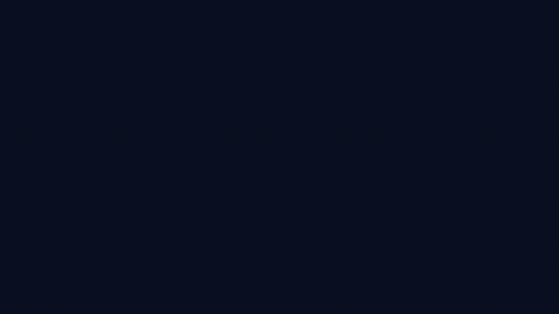
</p>
<p align="center">
  <a href="docs/media/spyglass-demo.mp4"><b>▶ Watch with voice-over (MP4, 57 s)</b></a><br>
  <sub>An illustration of the agent loop. Every render, heatmap and score in it is real Spyglass output from <code>samples/desktop-sample</code>.</sub>
</p>

<table>
  <tr>
    <th>Design target</th>
    <th>First attempt</th>
    <th><code>spyglass diff</code> heatmap</th>
  </tr>
  <tr>
    <td></td>
    <td>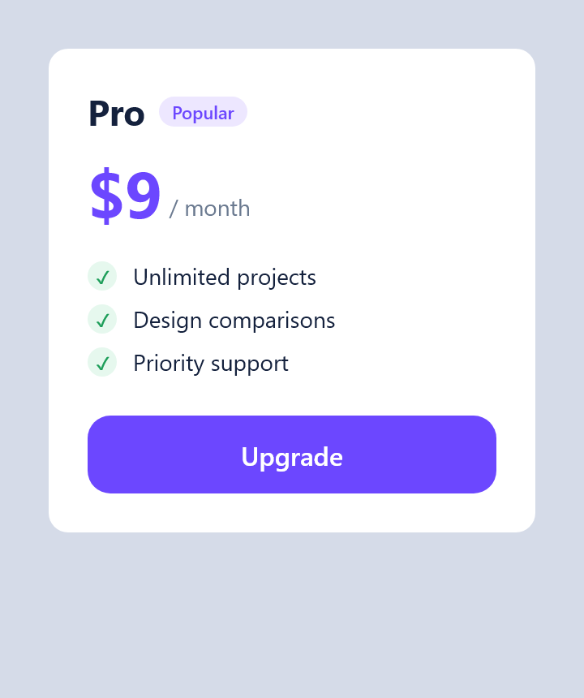</td>
    <td>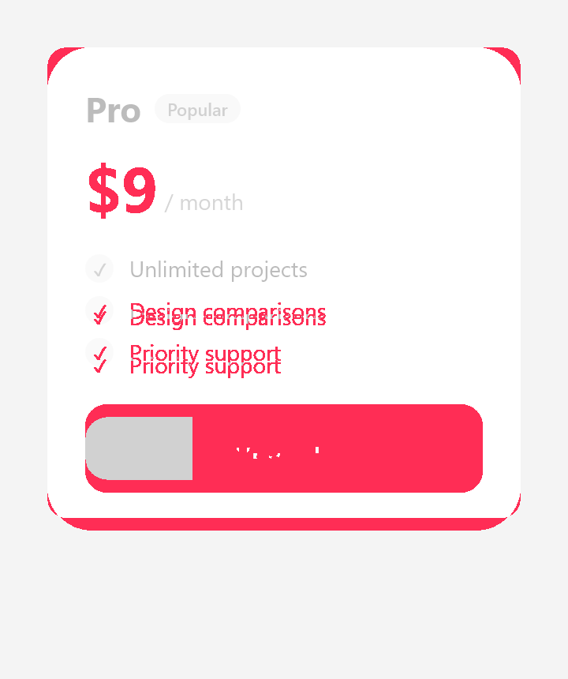</td>
  </tr>
  <tr>
    <td colspan="3" align="center">89.81% similar. Spyglass found 4 regions: the corners, the price colour, the list spacing and the button.</td>
  </tr>
</table>

> Status: early development (0.1.0). Previews in Compose Multiplatform shared (`commonMain`) and desktop code work today. Android-only previews are on the roadmap.

---

## The missing piece

AI coding agents write a lot of UI code now, and they write it **blind**. An agent can make a Compose screen compile, but it can't see that the padding is off, the text is clipped or the button is the wrong colour. You find out when you open the IDE. In the 2025 Stack Overflow developer survey, AI output that is "almost right, but not quite" was developers' most-cited frustration with AI tools, and UI is where "almost right" is hardest to spot in code.

The ways to see a Compose preview today were built for people, or for regression tests:

| | Needs an IDE running | Changes to your build | Made for agents | Compares with a design mock |
|---|---|---|---|---|
| Android Studio preview | Yes | None | No | Only through Gemini inside the IDE ("Match UI to Target Image") |
| Android CLI `render-compose-preview` (Google, May 2026) | Yes: Android Studio with the project open | None | Yes: returns an image path and UI hierarchy | No |
| Screenshot-test libraries (Paparazzi, Roborazzi, Compose Preview Screenshot Testing) | No | Plugin, dependencies, test sources, recorded baselines | No: they are test frameworks | They check against recorded baselines, not a design |
| **Spyglass** | **No** | **None** (applied at run time) | **Yes: MCP server, images returned inline** | **Yes: score, regions in px/dp, heatmap** |

Screenshot-test libraries are great at what they do: stopping regressions once the UI is right. Spyglass covers the step before that, **getting the UI right in the first place**, in a loop an agent can run by itself:

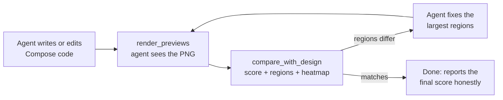

---

## Walkthrough: see, compare, fix

The three versions of the card above are real previews in [`samples/desktop-sample`](samples/desktop-sample/src/commonMain/kotlin/sample/Demo.kt), so you can reproduce every image and number here. They play the parts of a designer's mock, a typical first attempt, and the fixed version.

**1. Render.** `spyglass render` finds every `@Preview` and draws it:

```text
$ spyglass render --filter Demo
spyglass: rendered 3/3 previews
  ok     DemoKt.DemoDesignTarget [Design target]  720x860px  .../build/spyglass/previews/DemoKt.DemoDesignTarget_Design_target.png
  ok     DemoKt.DemoFirstAttempt [First attempt]  720x860px  .../build/spyglass/previews/DemoKt.DemoFirstAttempt_First_attempt.png
  ok     DemoKt.DemoAfterFix [After fix]  720x860px  .../build/spyglass/previews/DemoKt.DemoAfterFix_After_fix.png
```

**2. Compare with the design.** `spyglass diff` scores the render and lists the regions that differ, largest first, with a rough position an agent can act on:

```text
$ spyglass diff DemoKt.DemoFirstAttempt_First_attempt.png DemoKt.DemoDesignTarget_Design_target.png
spyglass diff: 89.81% similar (63095 of 619200 px differ)
  heatmap: .../DemoKt.DemoFirstAttempt_First_attempt.diff.png
  regions that differ, largest first (px, then dp at density 2.0):
    1. center        x=44 y=374 616x308px  (22,187 308x154dp)  31.22% of it changed
    2. top-left      x=110 y=198 88x88px  (55,99 44x44dp)  36.25% of it changed
    3. top-left      x=44 y=44 66x66px  (22,22 33x33dp)  12.10% of it changed
    4. top-right     x=616 y=44 44x66px  (308,22 22x33dp)  18.11% of it changed
```

Read with the heatmap, that is: the feature list and button (tighter spacing pushed them up, and the button lost its gradient), the price (wrong colour), and the top corners (radius 12dp instead of 28dp).

**3. Fix and compare again.** After fixing those, one small region is left:

<table>
  <tr>
    <th>After fix</th>
    <th>Heatmap</th>
  </tr>
  <tr>
    <td>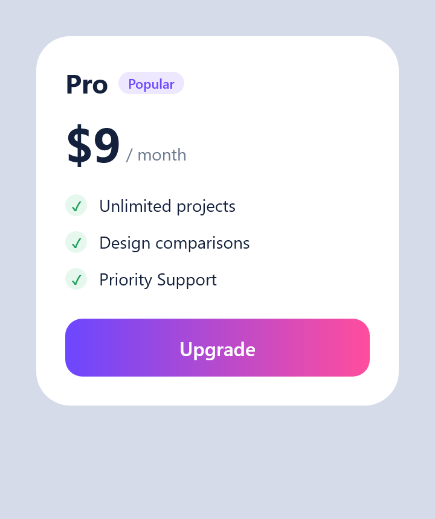</td>
    <td>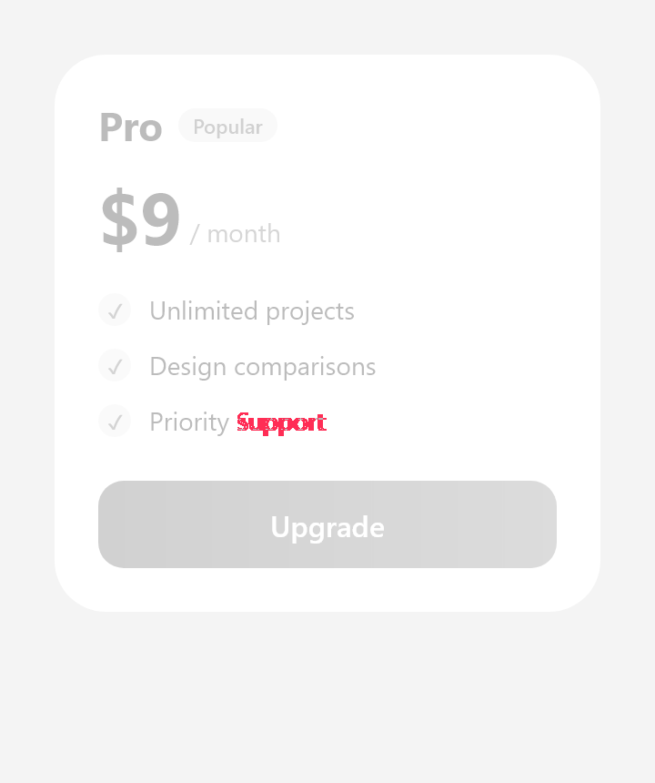</td>
  </tr>
</table>

```text
spyglass diff: 99.82% similar (1090 of 619200 px differ)
  regions that differ, largest first (px, then dp at density 2.0):
    1. center        x=242 y=440 132x44px  (121,220 66x22dp)  18.77% of it changed
```

That region is the word "Support": the fixed version says "Priority Support", the design says "Priority support". Small enough to miss by eye, obvious in the heatmap.

Through MCP, an agent gets all of this from one `compare_with_design` call: a compact JSON summary plus a single image strip (render | design | heatmap), about 640 tokens in total.

---

## What renders today

Real output from the sample project, cropped to each preview's content:

<table>
  <tr>
    <td>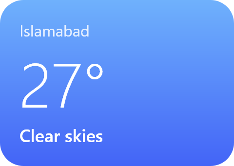</td>
    <td>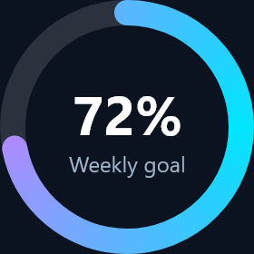</td>
    <td><br><br>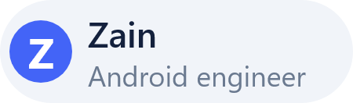</td>
    <td>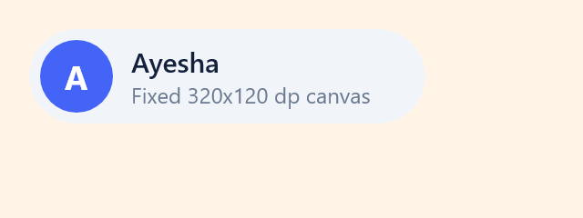</td>
  </tr>
  <tr>
    <td>Gradients and text</td>
    <td><code>Canvas</code> drawing, <code>backgroundColor</code></td>
    <td>Two <code>@Preview</code>s on one function, one with <code>fontScale = 1.5f</code></td>
    <td><code>widthDp</code> / <code>heightDp</code></td>
  </tr>
  <tr>
    <td colspan="2">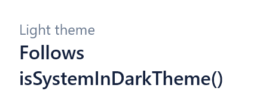 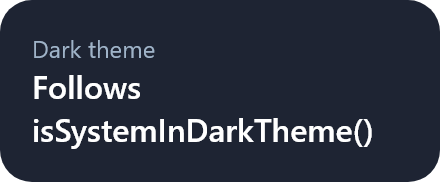</td>
    <td colspan="2"> 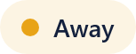 </td>
  </tr>
  <tr>
    <td colspan="2"><code>@PreviewLightDark</code> from the Compose library: <code>isSystemInDarkTheme()</code> follows the preview's <code>uiMode</code></td>
    <td colspan="2"><code>@PreviewParameter</code>: one image per value from the provider</td>
  </tr>
</table>

Also supported: previews inside an `object` or class, `device = "spec:width=…dp,height=…dp"` sizes, `@PreviewFontScale`, `@PreviewScreenSizes`, and multi-preview annotations declared in another module, such as a shared design system.

A preview that throws doesn't stop the run. It is reported with its error and the line in your code:

```text
  error  BrokenKt.BrokenPreview  IllegalStateException: Intentional failure to test error reporting (at sample.BrokenKt.BrokenPreview(Broken.kt:10))
```

---

## How it works

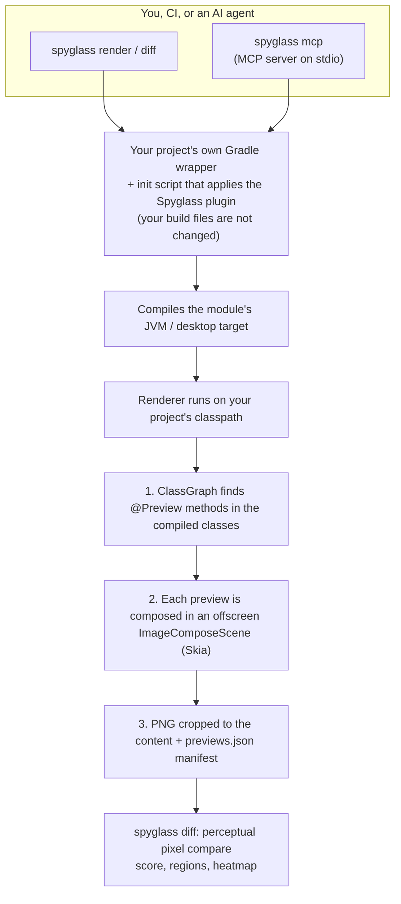

**1. No build changes.** The `spyglass` CLI carries the Gradle plugin inside it. When you run `spyglass render`, it starts your project's own `gradlew` with an init script (`-I spyglass.init.gradle`) that applies the plugin to every project for that run only. Nothing in your repository is edited, and your Gradle, Kotlin and Compose versions are the ones used.

**2. A plugin that works anywhere.** The Gradle plugin is written in Java and deliberately avoids Kotlin Gradle Plugin classes, because an init script loads it in a separate class loader. It finds your Kotlin Multiplatform JVM target (`jvm()` or `jvm("desktop")`) by reading the `org.jetbrains.kotlin.platform.type` attribute on Gradle configurations, then registers `spyglassRender`. Plain Kotlin/JVM modules work too. A module without a JVM target (Android-only, iOS-only, JS) is skipped with a message instead of failing the build. It works with the configuration cache on, and the per-build settings stay fixed so the cache is reused between runs.

**3. Rendering on your classpath.** `spyglassRender` runs the renderer in a JVM whose classpath is your module's compiled desktop jar plus its runtime dependencies, so your composables, resources and Compose version are exactly what ship. The renderer itself compiles against Compose only as `compileOnly`.

**4. Finding previews without loading your code.** [ClassGraph](https://github.com/classgraph/classgraph) scans the compiled classes for methods carrying `@Preview`. That annotation has `BINARY` retention, so it isn't visible to normal reflection but is in the class files. Spyglass recognises:
- `androidx.compose.ui.tooling.preview.Preview` (the common annotation since Compose Multiplatform 1.10)
- the deprecated JetBrains and desktop `@Preview`s
- repeated `@Preview`s on one function
- multi-preview annotations, wherever they are declared. When a preview uses an annotation that isn't in the module, such as `@PreviewLightDark` or your design system's own, Spyglass runs a second, targeted scan of just those annotation classes on the runtime classpath.
- `@PreviewParameter` on the preview's parameter: the provider is created and each of its values (up to its `limit`, at most 50) becomes its own image.

**5. Calling a composable by reflection.** A `@Composable fun Foo()` compiles to a method `Foo(Composer, int)`, or `Foo(value, Composer, int)` with a `@PreviewParameter`. Spyglass composes a host inside an offscreen `ImageComposeScene` and invokes the preview method with the scene's current `Composer`. Previews in a Kotlin `object` are called on its `INSTANCE`, and previews in a class on a new instance. During the render:
- `LocalInspectionMode` is `true`, as in the IDE.
- Compose desktop's system theme is pinned: light, or dark when `uiMode` asks for night. `isSystemInDarkTheme()` gives the same answer on every machine, and dark variants really render dark.
- Two frames are rendered, so state set in the first frame's effects shows up.
- The content is measured and the PNG is cropped to it. `widthDp` / `heightDp` or a `device = "spec:…"` size (exact with `showSystemUi`) fixes the canvas instead.
- `fontScale`, `showBackground` and `backgroundColor` are applied.
- Compose's own error log is captured, so a crashing preview becomes one line that points at your code (`Broken.kt:10`), not a stack trace.

**6. A manifest for machines.** Every run writes `build/spyglass/previews/previews.json` with each preview's function, `@Preview` name, parameter value, status, image path, size and error, and adds its path to a report file the CLI reads. `spyglass render --json` prints a compact version, with image paths relative to the project root:

```json
{"root":"/work/app","rendered":2,"failed":1,"previews":[{"preview":"CardsKt.WeatherCardPreview","image":"build/spyglass/previews/CardsKt.WeatherCardPreview.png","px":"480x341"},{"preview":"VariantsKt.StatusChipPreview (Online)","image":"build/spyglass/previews/VariantsKt.StatusChipPreview_0.png","px":"168x61"},{"preview":"BrokenKt.BrokenPreview","error":"IllegalStateException: … (at sample.BrokenKt.BrokenPreview(Broken.kt:10))"}]}
```

**7. Comparing images like a person would.** `spyglass diff` flattens both images onto white and scales the design to the render's size if they differ. It then compares every pixel with the YIQ colour distance used by [pixelmatch](https://github.com/mapbox/pixelmatch), so `--threshold 0.1` means what it does there. To turn changed pixels into something an agent can act on:
- the image is split into a grid, and cells with only stray anti-aliasing changes are ignored
- touching cells are joined into regions, and regions that nearly touch are merged, so "27°" is one region rather than two digits
- each region is reported with a rough position (`top-left`, `center`...) and the share of its pixels that changed. The human output gives px and dp; the JSON gives `[x, y, w, h]` in dp, the unit Compose code is written in.
- if the design's aspect ratio differs from the render's by more than 2%, the result carries a warning, because stretching skews the comparison.

**8. An MCP server that speaks old and new MCP.** `spyglass mcp` serves the stateless 2026-07-28 revision of the Model Context Protocol (version in each request's `_meta`, plus `server/discover`). It also answers the older `initialize` handshake (2024-11-05 to 2025-11-25), so it works with clients on either. Problems the agent can fix come back as tool errors with the details:
- a compile error, with the compiler's message, file and line
- a crashing preview
- an ambiguous preview name, with the exact choices

**9. Built to be cheap in tokens.** An image costs an agent roughly width × height / 750 tokens, and every word of a tool schema is loaded into every session. So:
- Tool descriptions are short.
- Results are compact JSON with no empty fields.
- Images are scaled to 640 px on the long side by default (`imageMaxPx` to change it).
- A comparison comes back as one labelled strip instead of three full images.
- Gradle's generic advice is trimmed from error output.

| MCP call (sample project) | Before tuning | Now |
|---|---|---|
| `compare_with_design` on the plan card | ~2,900 tokens | ~640 tokens |
| `render_previews` with three 720×860 previews | ~2,850 tokens | ~1,530 tokens |

---

## Install

From source for now:

```bash
git clone https://github.com/zainkhalid91/spyglass
cd spyglass
./gradlew :cli:installDist
```

The launcher is `cli/build/install/spyglass/bin/spyglass` (`spyglass.bat` on Windows). Copy the `cli/build/install/spyglass` folder somewhere stable and add its `bin` to your `PATH`. Requires JDK 17+.

## Use

```bash
cd /path/to/your/project
spyglass render                       # every module with a JVM target
spyglass render --module :shared      # one module (inferred when run from a module folder)
spyglass render --filter Card --json  # matching previews only, JSON on stdout
spyglass diff render.png design.png   # compare; --fail-under 0.98 for CI
spyglass help
```

Images land in `<module>/build/spyglass/previews/`. Render options: `--density` (default 2), `--max-width-dp` / `--max-height-dp` (canvas limit for previews without a fixed size, default 1024), `--target` (JVM target name, detected by default), `--fail-on-error`.

## Use with AI agents

`spyglass mcp` is a standard MCP server on stdio, so any MCP client can use it. It has three tools:

| Tool | What it does |
|---|---|
| `render_previews` | Renders previews (optionally `filter`ed) and returns a compact summary plus the images. |
| `compare_with_design` | Renders one preview and compares it with a design image: score, regions in dp, and one render \| design \| heatmap image. |
| `diff_images` | Compares any two images. |

The server renders the project it is started in. Every tool also accepts `projectDir` and `module`, and `imageMaxPx` for image size.

In the examples below, replace the path with where you put Spyglass. On Windows, use `cmd` as the command with `["/c", "C:\\path\\to\\spyglass\\bin\\spyglass.bat", "mcp"]` as the arguments.

**Claude Code** (CLI, IDE extensions and the desktop app's Code tab):

```bash
claude mcp add --scope user spyglass -- /path/to/spyglass/bin/spyglass mcp
# Windows
claude mcp add --scope user spyglass -- cmd /c C:\path\to\spyglass\bin\spyglass.bat mcp
```

**Claude Desktop** (chat). In `claude_desktop_config.json` (Settings → Developer → Edit Config):

```json
{
  "mcpServers": {
    "spyglass": { "command": "/path/to/spyglass/bin/spyglass", "args": ["mcp", "--project", "/path/to/your/project"] }
  }
}
```

Claude Desktop doesn't start servers in your project folder, so `--project` sets the default. Tools can still pass `projectDir` to render another project.

**Cursor** (`~/.cursor/mcp.json` or `.cursor/mcp.json`), **Windsurf** (`~/.codeium/windsurf/mcp_config.json`) and **Gemini CLI** (`~/.gemini/settings.json`):

```json
{
  "mcpServers": {
    "spyglass": { "command": "/path/to/spyglass/bin/spyglass", "args": ["mcp"] }
  }
}
```

**VS Code / GitHub Copilot** (`.vscode/mcp.json`):

```json
{
  "servers": {
    "spyglass": { "type": "stdio", "command": "/path/to/spyglass/bin/spyglass", "args": ["mcp"] }
  }
}
```

**OpenAI Codex CLI** (`~/.codex/config.toml`):

```toml
[mcp_servers.spyglass]
command = "/path/to/spyglass/bin/spyglass"
args = ["mcp"]
```

**Claude Code skill:** copy [`skills/spyglass/`](skills/spyglass/SKILL.md) to `~/.claude/skills/`. It tells the agent when to render, how to work through a design comparison, and what the limits are. It falls back to the CLI when the MCP server isn't connected.

The first render in a project compiles it, which can take a minute or two; later renders reuse Gradle's caches. If your client times out on the first call, render once from the terminal first.

## Use the Gradle plugin directly

```kotlin
plugins {
    id("io.github.zainkhalid91.spyglass")
}
```

Then run `./gradlew spyglassRender`. Options are Gradle properties: `-Pspyglass.filter=<text>`, `-Pspyglass.density=2`, `-Pspyglass.maxWidthDp=1024`, `-Pspyglass.maxHeightDp=1024`, `-Pspyglass.target=<jvm target>`, `-Pspyglass.failOnError=true`. The plugin isn't published yet; [`samples/desktop-sample`](samples/desktop-sample) shows how to use it from this repository.

## Limits

- **Previews:** they must live in code compiled for a JVM (desktop) target. Previews that exist only in Android source sets, or use Android-only APIs, don't render yet.
- **Not supported yet:** locales, `device = "id:…"` device names (`spec:` sizes work), and `@PreviewWrapper`.
- **Fonts:** text uses the fonts available on the machine, so renders can differ slightly between operating systems. Compare renders made on the same OS, or use a looser `--threshold`.
- **Scores against other tools' mocks:** a mock drawn in another tool will rarely score above 90%, because fonts and anti-aliasing differ. Use the regions and the heatmap, not just the number.

## Roadmap

- Semantics tree output (text, sizes, touch targets) alongside each image
- Locales, `id:` device names, `@PreviewWrapper`
- Android-only previews
- Published Gradle plugin, CLI releases, and a Claude Code plugin bundle

## Project layout

| Module | What it is |
|---|---|
| [`renderer/`](renderer) | Kotlin. Finds previews with ClassGraph and renders them with `ImageComposeScene`. Runs on the rendered project's classpath. |
| [`gradle-plugin/`](gradle-plugin) | Java. Registers `spyglassRender` and ships the renderer inside its jar. |
| [`cli/`](cli) | Kotlin. The `spyglass` command: runs your Gradle wrapper with the bundled plugin, reads manifests, diffs images, and serves MCP. |
| [`skills/spyglass/`](skills/spyglass) | The Claude Code skill. |
| [`samples/desktop-sample/`](samples/desktop-sample) | A Compose Multiplatform project used for testing and for every image and score in this README and the demo video. |
| [`samples/edge-cases/`](samples/edge-cases) | A multi-module build covering cross-module multi-previews, `@PreviewParameter`, class previews, a `kotlin("jvm")` module and a module with no JVM target. |

## Windows note

Gradle fails with `Unable to establish loopback connection` when `TEMP` is an 8.3 short path like `C:\Users\JOHNSM~1\...`, which is common when the user name has spaces. `spyglass render` detects this and points `TEMP` at `<project>/.gradle/spyglass-tmp` for its Gradle run. If you run Gradle yourself, point `TEMP`, `TMP` and `-Djdk.net.unixdomain.tmpdir` at a folder without `~` or spaces.

## License

[MIT](LICENSE)
